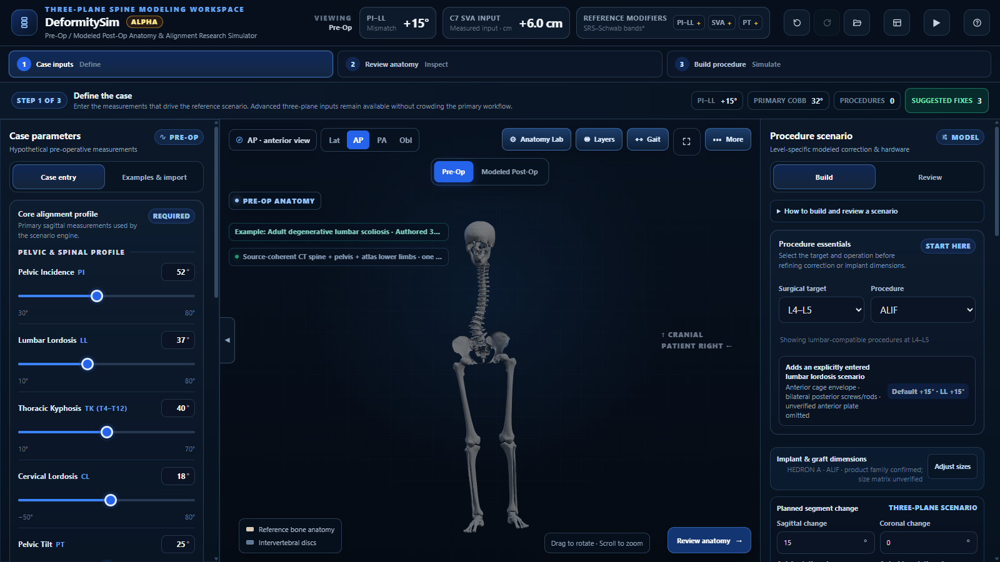
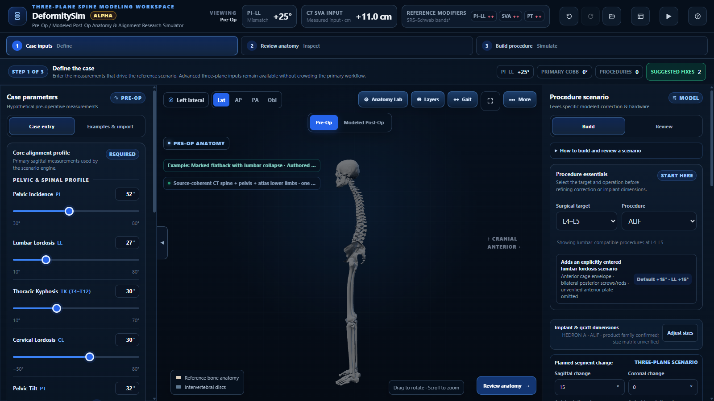
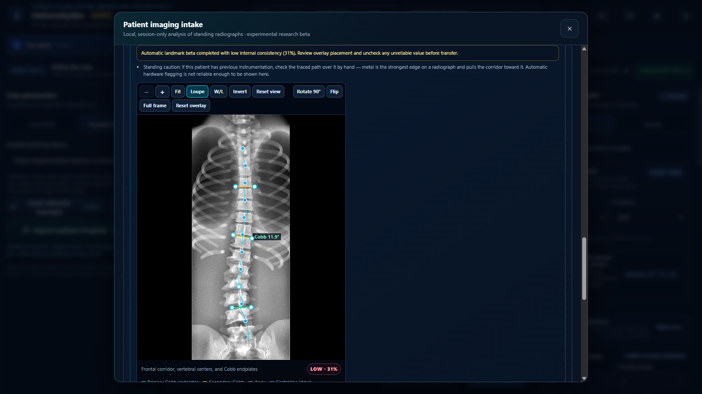

# DeformitySim

*Three-plane spinal deformity simulator*

**An open-source, offline, three-plane spinal deformity simulator for education and research
— with on-device radiograph landmarking. One HTML file. No install, no server, no network.**

> **Research and education use only.** DeformitySim is not a medical device, not
> surgical planning software, not patient-specific, and not clinically validated. It does not
> select treatment, establish eligibility, or predict an achieved correction. Do not enter
> identifiable patient information.

Version **0.23.0-alpha** · Licence **Apache-2.0** (code) · third-party data under their own
licences (see [NOTICE](NOTICE))



| Sagittal case in the lateral view | Radiograph review with view tools (synthetic phantom) |
|---|---|
|  |  |

---

## What it does

- **Author a hypothetical case in three planes** — pelvic incidence, lumbar lordosis,
  thoracic kyphosis (T4–T12), cervical lordosis, pelvic tilt, SVA, coronal Cobb / apex /
  translation and axial rotation — and see a CT-derived reference skeleton (31 bones from
  the skull base to the proximal femora, plus lower-limb anatomy) posed to those numbers in 3D.
- **Build a procedure itinerary** from 28 procedures: interbody fusion variants,
  decompressions, fixation, the full Schwab osteotomy ladder (grades 1–5), anterior column
  realignment, ACCF and thoracolumbar corpectomy with vertebral body replacement,
  laminoplasty, C1–C2 fusion, lumbar disc replacement and kyphoplasty. Default corrections
  and bounds are sourced from the literature and the sources are shown in the app.
- **See the modelled result**: pre-op vs modelled post-op alignment, SRS–Schwab modifiers,
  optional age-adjusted reference bands, evidence-linked construct comparisons, and a
  non-causal gait-cohort interpolation with foot–ground inverse kinematics.
- **Load standing radiographs locally** (PNG, JPEG, WebP, and DICOM including JPEG
  Lossless, RLE, baseline JPEG and deflated transfer syntaxes): drag-and-drop or paste a
  screenshot, get automatic vertebral landmarks, review and correct them (zoom, loupe,
  window/level, invert, rotate/flip, draggable landmarks with undo), or place landmarks
  manually, then apply the measurements to the case with per-value provenance.
- **Teach and present**: a 12-chapter guided demo, a pre-op vs post-op showcase, view
  presets, immersive mode, and projector-friendly text scaling.
- **Save and share cases** as small JSON files (parameters and procedures only — never
  images or file names), with undo/redo for case edits.

## Privacy by architecture

The page declares a strict Content-Security-Policy (`connect-src 'none'`, no workers, no
WebAssembly, no eval) and makes **no network requests at all**. Images are decoded and
analysed in the browser tab and are never uploaded. DICOM identity tags (group 0010,
institution, physician, private tags) are never read. The optional review download is a
local file created only after an explicit warning about burned-in identifiers.

## Quick start

1. Download `dist/deformitysim.html` (or clone the repository).
2. Open it in a current Chrome, Edge, Firefox or Safari — directly from disk is fine.
3. Choose **Start guided demo** or **Explore on my own**.

WebGL is required for the 3D view.

## Radiograph landmarking engines

- **Classical engine** (always available): corridor tracing, endplate search and Cobb
  pairing written for this project; lateral tracing is experimental and its level-named
  outputs are shown as low-confidence estimates — manual or guided landmarks are the route
  to trusted lateral values.
- **Neural AP engine** (optional, full builds only): the published vertebra-landmark
  network of Yi et al. (ISBI 2020), converted for in-browser inference on the device GPU,
  gated by anatomical plausibility checks and by a load-time numeric self-test of all
  network outputs against a CPU reference. **The public repository does not include the
  model weights**, because the authors published them without a licence statement. See
  [`ai-tools/README.md`](ai-tools/README.md) for how to build with weights you obtain
  yourself.

## Building from source

The editable source lives in `src/` (fragments listed in `src/manifest.json`). Node.js 18+
is the only requirement.

```bash
node tools/build.js --no-model --out dist/deformitysim.html   # public build (~4 MB)
node tools/build.js                                              # full build (needs ai-tools/assets/weights.b64)
```

## Tests

```bash
node audit-tools/check_html.js dist/deformitysim.html
node audit-tools/v2_static_probe.js dist/deformitysim.html
node audit-tools/interaction_harness.js dist/deformitysim.html
node audit-tools/scene_harness.js dist/deformitysim.html
node ai-tools/dicom-tests/test.js
node audit-tools/release_tests.js dist/deformitysim.html
```

The `audit-tools/*_tests.js` suites drive a real Chrome/Edge through the DevTools protocol
(`audit-tools/cdp.js`, no dependencies); a few film-flow checks skip when the internal
sample radiographs are not present. `deploy/tests/run.php` covers the optional PHP hosting
package in `deploy/`.

## Repository layout

```
src/            editable application source (HTML, CSS, JS fragments, atlas data)
tools/build.js  assembles src/ into the single-file app and embeds imaging assets
dist/           prebuilt public build (no neural weights)
ai-tools/       DICOM decoder, neural runtime, self-test, export pipeline, DICOM tests
audit-tools/    static checks, Node vm scene harness, real-browser test suites
deploy/         optional Apache/PHP package for authenticated hosting
docs/           development notes
```

## Known limits

- One CT-derived reference skeleton posed to your numbers — not the patient's anatomy.
- Procedure effects are authored from published ranges; ceilings are authoring bounds, not
  published limits. Gait figures are cross-sectional cohort interpolation, not prediction.
- Automatic landmarking is experimental and requires human review; the neural model was
  trained on full-length AP scoliosis films and is out of distribution for cropped,
  lateral, heavily instrumented or low-resolution images.
- CT series intake is blocked; prior-hardware detection is deliberately switched off.

See [TESTING_README.md](TESTING_README.md) for the full statement of what the tool is and is
not, and [CHANGELOG.md](CHANGELOG.md) for what changed in this release.

## Citing

If you use DeformitySim in research or teaching, please cite it using
[CITATION.cff](CITATION.cff).

## Licence

Code: Apache License 2.0 ([LICENSE](LICENSE)). Embedded third-party runtimes and data keep
their own licences — three.js (MIT), TensorFlow.js (Apache-2.0), the TotalSegmentator-derived
atlas (CC BY 4.0) and the BodyParts3D-derived lower-limb atlas (treated as CC BY-SA 2.1 JP,
the more restrictive of its two published licences). Details and attributions: [NOTICE](NOTICE).
